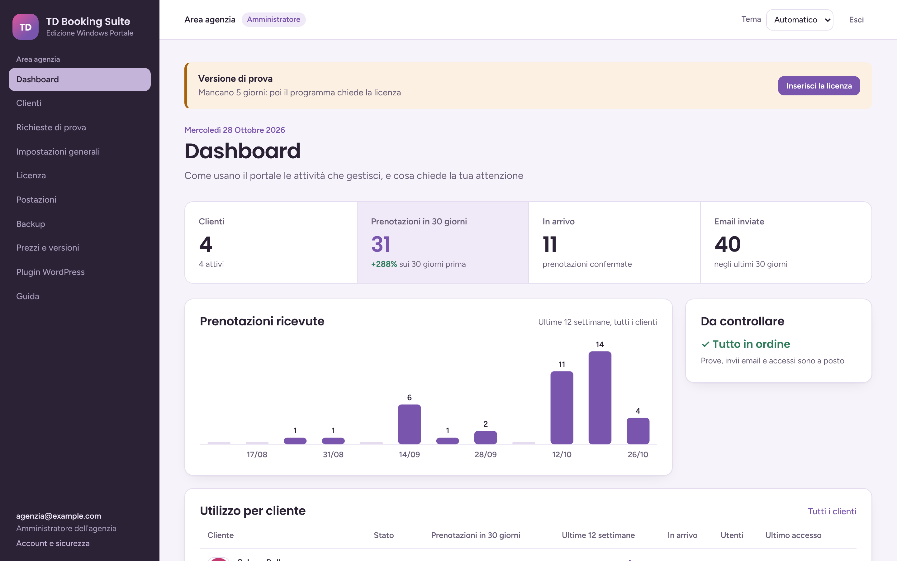
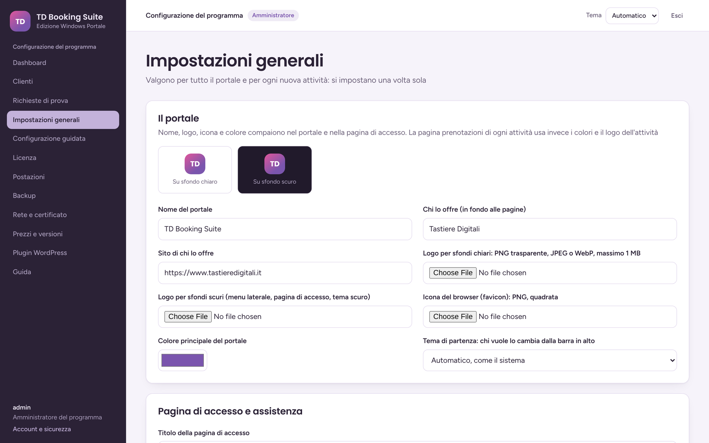

# TD Booking Suite per Windows

**Prenotazioni, agenda e clienti in un programma per Windows: i dati restano sul tuo PC, in ufficio.**

TD Booking Suite gestisce appuntamenti, tavoli, camere, lezioni ed eventi. Si installa su un PC dell'ufficio, che fa da server, e si usa da tutte le postazioni della rete, dal browser e dal telefono. Lo fa [Tastiere Digitali](https://tastieredigitali.tech).

**[Scarica l'ultima versione](../../releases/latest)**: un solo file MSI, per il server e per le postazioni. I primi 7 giorni sono di prova gratuita, con tutte le funzioni.

| | |
|---|---|
|  |  |
| **Dashboard**: prenotazioni, clienti e cosa chiede attenzione | **Tema chiaro o scuro**, con il colore che preferisci |
|  |  |
| **Postazioni**: ogni PC si registra una volta con un codice di 6 cifre | **Backup automatici**, cifrati, su disco esterno, NAS o server remoto |
|  |  |
| **Importa i clienti** dal programma di prima, da Excel o CSV | **Anteprima** prima di importare: cosa entra e cosa no |
|  |  |
| **Rete e certificato**: indirizzo pubblico, proxy e certificato, solo per l'amministratore | **Il tuo marchio**: nome, loghi, colore principale e tema di partenza |

## Cosa fa

- **Agenda e prenotazioni** per parrucchieri, centri estetici, SPA, ristoranti, studi, autoscuole, officine, hotel, case vacanza, noleggi, tour ed eventi. Ci sono gli orari, le risorse e gli operatori, e le domande giuste per ogni tipo di attività.
- **Prenotazioni online** dalla pagina dell'attività, quando il server è raggiungibile da Internet, con conferme e promemoria per email.
- **Clienti**: scheda con lo storico, le note, i trattamenti, le intolleranze e i consensi marketing.
- **Importa dal programma di prima**: anagrafica e storico dei trattamenti da Excel o CSV. Per ogni colonna scegli cosa contiene e guardi l'anteprima prima di importare. Chi c'è già non viene sovrascritto né raddoppiato. I consensi marketing restano da confermare dal cliente.
- **Una o più attività**: la versione singola è per un'attività, la versione portale per chi ne gestisce diverse.
- **Più postazioni**: i PC della rete usano il programma per la postazione; browser e telefono vanno bene lo stesso. Le sedi lontane si collegano allo stesso server.
- **Da fuori dall'ufficio**: dietro un proxy con il suo certificato (NPMplus, Caddy, IIS) o con un tuo certificato caricato nel programma. Anche i certificati autofirmati vanno bene: le postazioni li riconoscono dall'impronta. Il programma per le postazioni si collega anche alla versione web su Docker.
- **Sicurezza**:
  - HTTPS anche in rete locale;
  - secondo fattore con Authenticator o passkey;
  - dati di ogni attività cifrati e separati;
  - ogni parte del programma con i suoi permessi di Windows.
- **Backup automatici ogni notte**, cifrati con la tua password, su disco esterno, NAS, FTP, FTPS o SFTP. Il ripristino si fa dal menu Start.
- **Il tuo marchio**: nome, loghi, icona, colore principale e tema di partenza si cambiano dalle impostazioni.

## Installare

### Windows ti avvisa: si installa lo stesso

Il file non ha ancora una firma digitale, quindi Windows non sa chi lo pubblica e lo segnala:

1. **Edge o Chrome** dicono che il file *non viene scaricato comunemente*. Apri il menu **…** del download, poi **Mantieni**, **Mostra altro** e **Mantieni comunque**.
2. **Windows ha protetto il PC**, la finestra blu di SmartScreen: premi **Ulteriori informazioni** e poi **Esegui comunque**.
3. Se il file arriva da una chiavetta o da una email e non parte: tasto destro, **Proprietà**, spunta **Sblocca**, **OK**.

### Sul PC che fa da server

1. Apri l'MSI, accetta la licenza d'uso e lascia attivi **Server** e **Programma per la postazione**. Dai il permesso di amministratore: la prima volta servono un paio di minuti.
2. Alla fine apri TD Booking Suite, premi **Collegati** e poi **Continua**, e crea l'**amministratore del programma**.
3. In **Licenza** attiva la **prova di 7 giorni**, oppure incolla la licenza.
4. In **Clienti** crea la tua attività, in **Backup** attiva il backup automatico.

|  |  |
|---|---|
| **Primo avvio**: l'amministratore si crea solo dal PC server | **Licenza**: cosa consente e il codice installazione da mandarci |

### Sulle altre postazioni

1. Installa lo stesso MSI togliendo **Server**.
2. Al primo avvio scrivi l'indirizzo del server, per esempio `https://ufficio-pc:8443`, e controlla che l'impronta del certificato sia la stessa della pagina Postazioni del server.
3. Sul server, in **Postazioni**, genera il codice e scrivilo sulla postazione.

Da browser o telefono basta aprire l'indirizzo del server e inserire il codice.

## La licenza

Dopo i 7 giorni di prova il programma chiede la licenza. Prenotazioni e clienti restano salvati, e i backup continuano. La licenza dice:

- quante **attività** puoi gestire: 1 per la versione singola, di più per il portale;
- quante **postazioni in rete** puoi usare, oltre al PC server;
- se c'è una **scadenza**.

### Come acquistare

Prezzi e formule sono su richiesta. **Contattaci da [tastieredigitali.tech](https://tastieredigitali.tech)** e mandaci il **codice installazione** che trovi nella pagina Licenza del programma: ti spieghiamo le formule e ti mandiamo la licenza per il tuo PC. La incolli nella stessa pagina e il programma riparte subito, con tutti i dati.

## Requisiti

- Windows 10 o 11 a 64 bit. Sul server bastano 4 GB di RAM e qualche GB libero.
- Sulle postazioni serve Microsoft Edge WebView2, già presente su Windows 11 e sui Windows 10 aggiornati. Se manca, il programma lo dice e porta alla pagina per scaricarlo.
- Per le postazioni fuori dall'ufficio, il server deve essere raggiungibile da Internet, oppure si usa un server Windows in cloud.

## Domande

**Dove sono i miei dati?** Sul PC server, in `C:\ProgramData\TD Booking Suite`, e nei backup che scegli tu. Non passano da nostri server.

**Posso aggiornare senza perdere niente?** Sì: apri l'MSI nuovo sopra quello vecchio. Prima di aggiornare il programma salva da solo una copia del database.

**E se cambio PC?** Installa il programma sul PC nuovo e ripristina un backup dal menu Start. Poi chiedici la licenza con il nuovo codice installazione.

**Esiste una versione web, senza Windows?** Sì: il nucleo web di TD Booking Suite è open source, su [github.com/Giuseppe-sciarra/TD-Booking-Suite](https://github.com/Giuseppe-sciarra/TD-Booking-Suite), e si installa con Docker su un server Linux.

---

TD Booking Suite per Windows © Tastiere Digitali. Il programma si usa con una licenza di Tastiere Digitali, o nei 7 giorni di prova. I componenti di terze parti inclusi restano sotto le loro licenze, elencate nell'installer.
